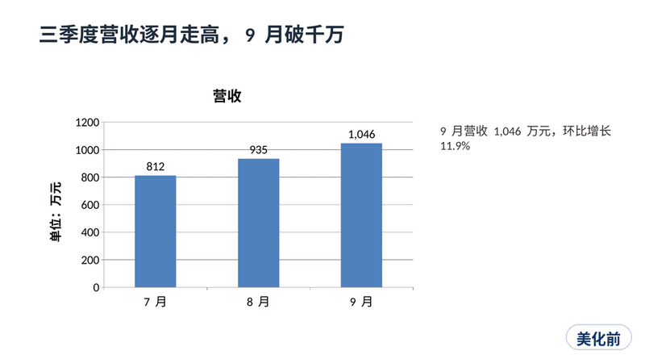
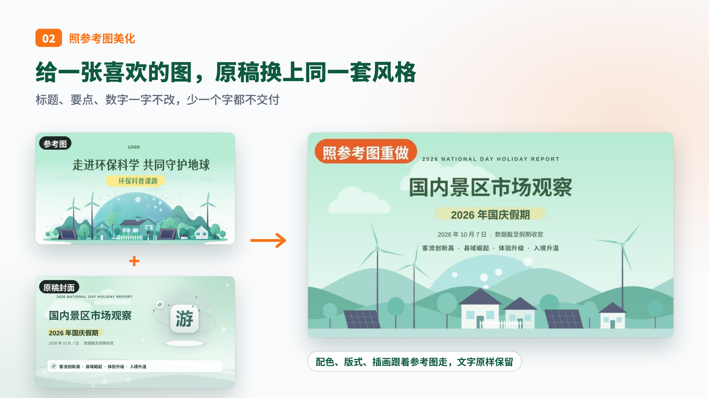
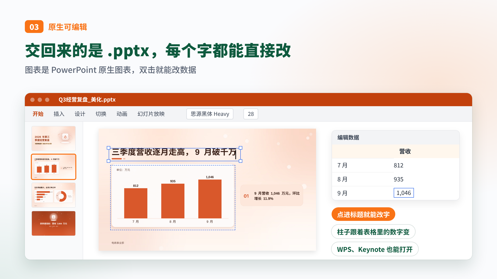
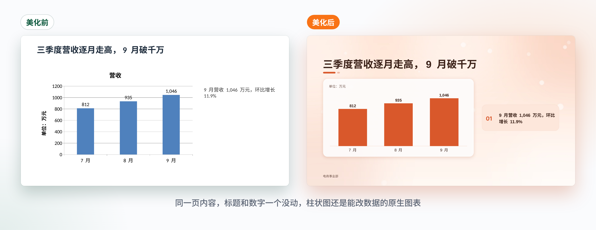

<div align="center">

<picture>
  <source media="(prefers-color-scheme: dark)" srcset="docs/images/banner-dark.png">
  <source media="(prefers-color-scheme: light)" srcset="docs/images/banner-light.png">
  
</picture>

[](LICENSE)
[](#更新记录)
[](#效果示例)
[](#安装)
[](https://agentskills.io)

<br>



<br><br>

**一个做 PPT 和美化 PPT 的 Agent Skill，装进 Agent 发一句话就能用。**

```text
帮我安装这个 skill：https://github.com/zhouwei713/luobo-ppt
```

[效果示例](#效果示例) · [安装](#安装) · [使用方式](#使用方式) · [它解决什么](#它解决什么) · [工作原理](#工作原理) · [14 套风格](#14-套风格)

</div>

---

## 三件事

### 从零生成

给它一个题目、一篇文章、一份口播稿或大纲，它先写出结论式标题和口播备注，再排版、配图、加动画。


### 照参考图美化

给它一份朴素的 .pptx 和一张参考图，它把原文一字不改地搬进统一的配色、版式、图标和插画里，少一个字都不交。



### 原生可编辑

文字是文本框，表格是真表格，图表是 PowerPoint 原生图表，双击就能改数据。PowerPoint、WPS、Keynote 都能打开。



---

## 效果示例

### 同一页内容，美化前后

左边是原稿，右边是换上暖橙风格之后的样子。标题和数字一个没动，柱状图还是能改数据的原生图表。



### 文字一个不动，换身衣服

上面一排是原稿，下面一排是给了一张薄荷绿参考图之后美化出来的。标题、要点、数字一个字都没改，换掉的是配色、版式、图标和插画。


### 同一份原稿，换一张参考图就是另一套风格

从上往下依次是原稿、薄荷参考图、深色科技、墨水杂志。四个版本文字完全一样。


### 参考图里有什么，封面就画什么

参考图是一张环保科普封面，山坡上立着风车。美化后的封面照着参考图的元素画出了风景，整张图没接任何 AI 生图模型，是程序画出来的。


### 理科课件，公式一个不丢

一份高中数学导数复习课，原稿里有 12 个用公式编辑器打的公式，在 LibreOffice 里打开全是空白。解析时它会把这类公式转成普通文字公式，换什么软件都看得到，也能直接改字。


### 一篇文章，直接变成能讲的 PPT

把一篇公众号文章丢给它，生成 15 页的口播 PPT。它先写一份只有标题的"幽灵稿"让你确认，每页标题都是一句结论，每页都带口播备注。


### 数据、流程、分析框架也装得下

时间线、漏斗、中心辐射、2x2 矩阵、原生表格、原生图表，外加 SWOT、PEST、波特五力、商业画布。表格是真表格，图表双击就能改数据。


### 工具教程的截图有专门的版式

一张截图配几条说明，说明里写上位置，截图上就打一个对应的编号点。几张截图走一个流程，按各自的宽高比分配宽度，中间自动加箭头。


---

## 它解决什么

AI 做的 PPT，常见的毛病就这几样。

- 整页是一张图片，看着漂亮，错一个字也改不了
- 能编辑的又是一股模板味，谁做出来都长一个样
- 内容装不下就把字越缩越小，投到墙上看不清
- 美化的时候顺手把原文"润色"了，丢了一句都不知道
- 标题写成"数据分析""项目介绍"，只读标题串不成一个故事
- 每页字号忽大忽小，强调色到处都是
- 原稿里的公式、编号、来源说明，美化完就没了

这个 Skill 把这些都变成了脚本能检查的规矩，交付前先过一遍。

---

## 适合什么场景

- 口播视频、公众号文章配套的讲解 PPT
- 拿到一份朴素的工作汇报、课件、方案，想照某张图的风格整体换装
- 理科和教学课件，公式多、示意图多
- AI 工具教程，截图多
- 数据复盘、竞品分析，需要原生表格、图表和分析框架
- 会议室投影，需要更大的字号下限

---

## 工作原理

两条路线共用一套设计引擎，中间靠三份文件串起来。

```text
路线 A 美化   原稿.pptx ──解析──┐
                               ├──> deck.json（每页内容） + style.json（风格） ──> plan.json（版式规划）
路线 B 生成   文章/题目 ──写稿──┘

plan.json ──> 出插画 ──> 组装原生 pptx ──> 渲染预览 ──> 自动检查 ──> 五维自评 ──> 交付
```

脚本负责确定性的活，Agent 负责理解内容和审美判断。

### 美化时少一个字，它都不交

原稿的每一段文字都会先存一份，美化完逐页核对。少一行字就报错，直接点名是哪一页、哪一句。


### 装不下的内容，写大纲时就拦住

每个版式都标了容量，比如漏斗最多 5 层、每层说明不超过 26 个字。超了就在大纲阶段提醒，排版时自动换一个装得下的版式。


### 出图以后，先给自己挑一遍刺

先查丢字、溢出、字压页脚、对比度、强调色用量这些硬伤，再把能数出来的证据列成表，从统一、层级、细节、传达、节奏五个方面给自己打分，要修的修完再交。


### 没装 LibreOffice 也能看图自检

预览默认用 LibreOffice 渲染。没装的话，它会按排版数据直接把每一页画出来，12 页大概 10 秒，左边是 LibreOffice，右边是近似画法。


### 没配生图模型也能用

背景、装饰和插画都有程序化的画法，上面所有的图都是在没接生图模型的情况下跑出来的。配了 OpenAI、Gemini、火山方舟、HiAPI 或任意 OpenAI 兼容接口，插画会更丰富，单张失败会自动退回程序化插画。

需要配图又没有模型时，Agent 会先问你想怎么配：现场接一个生图模型，去公开图库搜实拍图，用你自己的照片，还是用程序化插画。搜图只收能商用的图（CC0、公有领域、CC BY、CC BY-SA，配了 key 还能用 Pexels、Unsplash、Pixabay），照片会按图位裁好、加圆角和投影，需要署名的会单独列一份图片来源清单给你。

### 口播和讲课自带逐条出现的动画

翻页统一淡入淡出。口播稿、讲课这类边讲边放的稿子，卡片、步骤、数据卡会点一下出一条，标题和背景始终在页面上，不会出现飞入旋转这种抢戏的效果。汇报类默认只有翻页效果，想要也可以改成打开页面自动依次出现。静态预览看不出动画，可以单独出一张逐次出现的分镜图和动图来检查。

---

## 安装


仓库根目录就是 skill 本身（`SKILL.md` 在最外层），装好之后第一次使用时，Skill 会自己检查环境、补装缺少的 Python 包。

### 方式一：让 Agent 自己装

在 Claude Code、Codex、Gemini CLI、Cursor 这类能执行命令的 Agent 里直接说：

```text
帮我安装这个 skill：https://github.com/zhouwei713/luobo-ppt
```

Agent 会把仓库克隆到它自己的 skills 目录。装完开一个新会话就能用。

### 方式二：一行命令克隆

把仓库克隆到你的 Agent 的 skills 目录，目录名用 `luobo-ppt`。

```bash
# Claude Code
git clone https://github.com/zhouwei713/luobo-ppt.git ~/.claude/skills/luobo-ppt

# Codex 及其他支持 SKILL.md 开放标准的 Agent
git clone https://github.com/zhouwei713/luobo-ppt.git ~/.agents/skills/luobo-ppt

# Gemini CLI
git clone https://github.com/zhouwei713/luobo-ppt.git ~/.gemini/skills/luobo-ppt

# Cursor
git clone https://github.com/zhouwei713/luobo-ppt.git ~/.cursor/skills/luobo-ppt
```

Windows 上 `~` 是 `C:\Users\你的用户名`。只想在某个项目里用，就克隆到项目里的 `.claude/skills/`、`.agents/skills/` 这类目录。

用 [skills CLI](https://github.com/vercel-labs/skills) 的话，一行就行：

```bash
npx skills add zhouwei713/luobo-ppt
```

### 方式三：一键安装脚本

想一次装给电脑上所有的 Agent，并且提前把依赖装好：

```bash
git clone https://github.com/zhouwei713/luobo-ppt.git
cd luobo-ppt
bash install.sh
```

Windows 双击 `install.bat`，或在 PowerShell 里运行 `.\install.ps1`。脚本会自动找到装了哪些 Agent，分别装进去，检查并补装依赖，最后生成一份两页的小样做自测。只装给某一个 Agent 加参数就行，比如 `bash install.sh --agent codex`，更多参数见 [INSTALL.md](INSTALL.md)。

### 方式四：Claude 应用

在仓库页面点 Code → Download ZIP，在 Claude 应用的技能设置里上传这个压缩包。

### 更新

```bash
cd ~/.claude/skills/luobo-ppt && git pull   # 换成你实际的安装目录
```

### 依赖

| 类别 | 内容 |
|---|---|
| 必需 | Python 3.8+，python-pptx，Pillow，numpy，lxml，一款中文字体 |
| 推荐 | LibreOffice（预览更准），pdftoppm 或 PyMuPDF，requests（调用生图接口） |
| 可选 | 生图模型配置，见 `config.example.json` 和 `references/imagegen_config.md` |

`python3 scripts/setup_check.py --install` 会检查并安装缺少的部分。

---

## 使用方式

装好以后，跟 Agent 这么说：

```text
把这篇文章做成 12 页的口播 PPT，每页带口播备注，用墨水杂志风格。
```

```text
帮我美化这份 PPT，照着这张参考图的风格来，文字一个字都别改。
```

```text
这份数学课件帮我美化一下，公式都要保留。
```

```text
这是一篇工具教程，里面的截图帮我用截图版式排，操作点在截图上标出来。
```

```text
主题是"AI 工具号年度复盘"，给我出三张风格样张，我挑一个再往下做。
```

```text
这份 PPT 要在会议室投影，用投影模式，字号大一点。
```

赶时间可以加一句"快速模式"，它会跳过中间的确认环节。

---

## 14 套风格

没有参考图时，可以直接报名字。


| 风格 | 英文名 | 适合 |
|---|---|---|
| 薄荷清新 | mint-fresh | 科普讲解、工具教程、环保生活、小白入门 |
| 商务蓝 | business-blue | 工作汇报、方案提案、B 端产品、培训 |
| 暖橙活力 | warm-orange | 个人分享、活动宣传、营销增长、生活方式 |
| 深色科技 | dark-tech | AI 与科技产品、发布会、开发者内容 |
| 雾紫柔和 | lavender-soft | 情绪心理、美妆穿搭、读书感悟 |
| 纸感手记 | paper-notes | 读书笔记、方法论、个人成长、知识分享 |
| 黑金述职 | black-gold | 晋升述职、高层汇报、年度总结、高端品牌 |
| 几何色块 | geo-blocks | 运营复盘、团队年终、数据报告、市场活动 |
| 钴蓝字体 | cobalt-type | 设计分享、观点演讲、学术报告、创意提案 |
| 黑灰荧绿 | ink-lime | 业绩汇报、销售复盘、指标分析、项目进度 |
| 蓝粉柔雾 | pastel-mist | 实习汇报、校园分享、个人总结、轻量课程 |
| 蓝线发布 | wave-launch | 新品发布、科技大会、产品路线图、融资路演 |
| 墨水杂志 | ink-magazine | 观点分享、读书与人文、研究报告、个人品牌 |
| 硬边网格 | swiss-grid | 产品发布、方法论、数据复盘、设计提案 |

---

## 仓库结构

```text
.
├── SKILL.md                 Skill 主说明，Agent 读这个
├── INSTALL.md               安装说明
├── install.sh / install.ps1 / install.bat
├── config.example.json      生图模型配置模板
├── scripts/                 解析、规划、组装、渲染、检查、自评的全部脚本
├── references/              版式库、deck.json 字段、风格提取、14 套风格预设、自评规则
├── assets/                  图标库、风格样张
└── docs/images/             README 用图
```

---

## 设计理念

好看的 PPT 少有靠堆装饰撑起来的。它先要讲得清楚：只读标题能串成一个故事，每页字数装得下，字号就那么几级，强调色只给最关键的那一处。

AI 最容易偷懒的地方恰好是这些看不见的规矩。所以这个 Skill 把它们写成了能数出来的检查，丢字、溢出、字号乱、对比度不够，脚本先过一遍，再让 AI 看图挑刺。

交出去的永远是原生 PPT。不满意的地方你自己动两下就行，不用求着 AI 重新生成。

---

## 致谢

做这个 Skill 时参考过这些项目和资料，全部只提炼思路、自己改写，没有搬运原文和代码。

- dashi-ppt-skill：给每个版式标注容量的思路
- [open-design](https://github.com/nexu-io/open-design)：可检查的排版规则和五维设计评审
- 多个 PPT 设计网站的模板：归纳出 36 条视觉路线，目录与章节联动、装饰母题、投影模式都来自这里
- [Lucide](https://lucide.dev) 图标（ISC License，见 `assets/LICENSE-lucide.txt`）

---

## 更新记录

- 2.8.0 plan.json 每页可以用 `locked` 锁住手改的版式、图标、插画提示词，重新规划（包括 `--reset`）时照样保留；`plan_deck.py --replan 3,7` 只重排指定的页；内容装不下、自动换了版式时写 `layout_auto` 说明原因；改一页的动画不再触发重排
- 2.7.7 给旧稿子的页补上 `uid` 不再让 plan_deck 判定内容变了，手改过的版式规划照样保留
- 2.7.6 deck.json 每页可以带一个 `uid`，调整页序也不变，给外部工具认页用；QA 不再把它当成该上页面的文字
- 2.7.5 QA 关口更可信：手写的线条不再让 QA 崩溃；QA 崩溃时退出码是 2，pipeline 明说稿子没检查过；报告缺失或过期时 review 写“QA 没跑完”，不再显示错误 0；free 页的 elements 写在 deck.json 里也能用，重新规划时 plan 里手写的 elements 会保留，空的 free 页报 ERROR
- 2.7.4 大数字页的数字很宽时（比如“≤ 0.5 元 / 秒”），两行说明改排到数字下方，不再被挤出页面；QA 遇到页面外的文本框不再中途崩溃，整块在页面外或宽度为负的文字报 ERROR
- 2.7.3 主色是亮黄、珊瑚红这类浅色时：结尾页留在主色上配深色字，标签底用主色，主色块上的小字改深色，淡到看不见的连接线换成深色品牌色，QA 会提醒看不见的连接线
- 2.7.2 品牌主色是橙、黄这类浅色时，文字和大数字按手册的颜色顺序退到下一个读得清的品牌色，结尾页这类深色底改用最深的品牌色
- 2.7.1 品牌稿内页可以照手册用文字页眉，IP 形象按页挑选、按动作匹配内容，不再每页都放
- 2.7.0 按企业 VI 手册做 PPT：从手册拆页、截 logo 和形象，生成品牌套件，颜色只用手册色板，logo 按手册放并留安全空间，支持标题竖条、粗描边加硬投影这类标志性元素，QA 新增品牌检查
- 2.6.3 拿刁钻的经营复盘稿实测后补的：只存在表格格式里的百分号也能读出来，多条折线的末端数字带上单位，一页两三个图表、散点图、表格都能照抄，页面底部的注释不再被当成全篇页脚，注释和来源同时存在时两条都印
- 2.6.2 图表和小字单独核对：原稿图表的数据、单位、坐标轴标题逐项比对，注释和来源连符号一起核对，交付前出一份对照清单；快速模式也照常核对
- 2.6.1 讲解页也有逐条动画（多栏一栏一栏出来，单栏按讲解步骤出来），条目编号跟着条目一起出现
- 2.6.0 翻页效果和逐条出现的动画；没有生图模型时可以搜可商用的公开图库，或用自己的照片配图
- 2.5.0 解析原稿时自动转换公式对象，新增理科讲解版式，SVG 图自动转 PNG，原稿 logo 可原位保留
- 2.4.0 截图版式，不装 LibreOffice 的近似预览，字号阶梯按实际可用字号排版
- 2.3.x 标题字号全篇统一，原稿编号和小标签不再丢失，重跑规划保留手改内容
- 2.3.0 版式容量、行高按真实渲染计算、五维自评、墨水杂志和硬边网格风格

---

## License

MIT License. 图标遵循 Lucide 的 ISC License。
